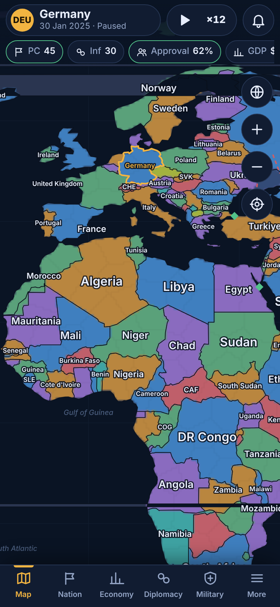
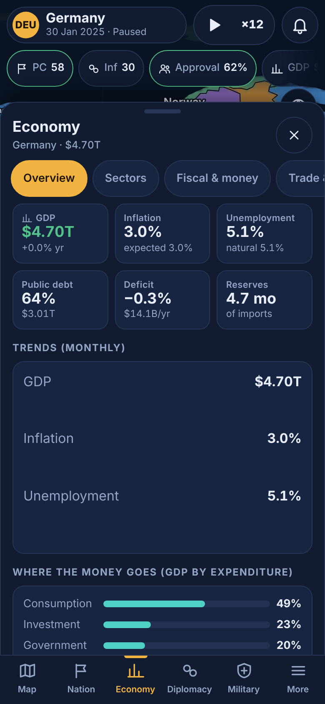
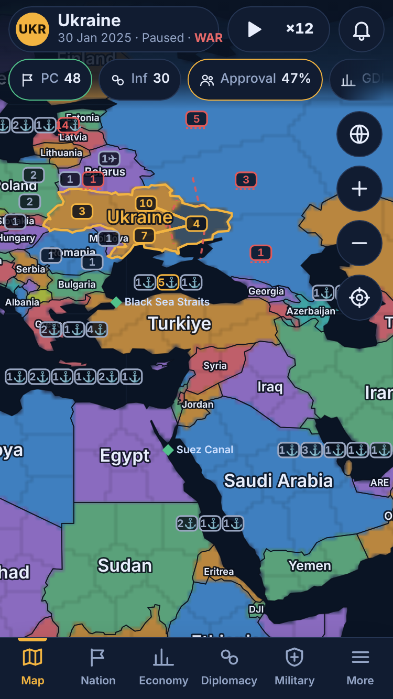

# MODERN AGE — Grand Strategy for iPhone

A modern-era (2025 →) grand-strategy simulation you play as one of **168 sovereign countries** on a
touch-first, offline, single-player world map. Politics, a trade-linked macro-economy, military logistics and
war, diplomacy and international organisations, intelligence and cyber, research, society and climate, events,
and a world run by AI actors that obey the same rules you do.

> **Status (honest summary).** The simulation, UI and tests are real and run. The game has been played
> end-to-end in **desktop Chromium with iPhone device emulation**. It has **not** been run on a physical iPhone,
> in iOS Safari/WKWebView, or built with Xcode (none available during development). See
> [docs/RELEASE_REPORT.md](docs/RELEASE_REPORT.md) and [docs/KNOWN_ISSUES.md](docs/KNOWN_ISSUES.md) for exactly what
> is verified and what is not.





(Screenshots are genuine captures of the running game in Chromium device emulation — see `tools/screenshots.mjs`.)

## Quick start

Requirements: Node ≥ 20 (22 recommended). The game itself has **no runtime dependencies**.

```bash
npm install            # only needed for the map build tool + dev tooling
npm run serve          # http://localhost:8080  — open on a phone browser on the same network, or use devtools device mode
npm test               # 73 unit tests + 22 UI tests (UI tests need Playwright + Chromium)
npm run validate:data  # content integrity
npm run bench          # simulation benchmark (desktop numbers, not iPhone)
npm run balance        # multi-scenario long-run validation -> docs/BALANCE_REPORT.md
npm run release:check  # all automated gates
```

Install as a PWA (Safari → Share → Add to Home Screen) or build the native shell: [docs/IOS_BUILD.md](docs/IOS_BUILD.md).

## What you can do

- Pick one of 168 countries and one of 6 scenarios (*Fault Lines 2025*, *A Quiet Decade*, *Energy Crunch*, *Strait Crisis 2027*, *The Long Drought 2025*, *Debt Reckoning 2026*), a
  difficulty, an AI-aggression setting and a seed. Same seed + same commands ⇒ identical game.
- Run the state: 11 policy levers (taxes, spending, tariffs, policy rate, regulation, environment, clean-energy
  priority, immigration, press freedom, surveillance, conscription), budget categories, industrial focus.
- Manage the economy: 8 sectors, trade, 4 traded commodities (food, oil, gas, minerals) with chokepoints
  (Hormuz, Suez, Malacca, Bosporus, Panama), sanctions and embargoes, inflation, debt, reserves, central bank.
- Research 67 technologies in 8 branches; modifiers feed back into production, military, society.
- Fight wars: ~1 270 land/air/naval formations, terrain, supply, air and naval phases, amphibious/strait rules,
  occupation, capitulation, war exhaustion, negotiated peace with transparent acceptance factors, client states (puppet terms: tribute, shared wars, revolt when the overlord weakens). Peace offers from the AI are put to you, never imposed.
- Do diplomacy: opinion/trust matrices, treaties, 14 international organisations, UN-style resolutions with a
  veto, sanctions, call-to-arms, proposals that show *why* a partner accepts or refuses.
- Run intelligence: networks, 8 covert operations, exposure risk, cyber disruption; the world is seen through
  noisy, delayed perception (fog of war).
- Ask the **advisor** (★ button) what to look at next; start a game in **Some/Wild world variation** for a different decade each seed; watch civil conflicts, shifting alliances and nuclear brinkmanship unfold.
- Launch national projects (rail, healthcare, nuclear, space, cyber command, …): multi-year investments that cost GDP share and grant permanent bonuses; the AI does too.
- Respond to ~80 authored events and world events (crises, pandemics, disasters, scandals) with branching decisions.
- Play 6 scenarios (incl. Strait Crisis, The Long Drought, Debt Reckoning) and pursue 6 victory paths (prosperity, economic, diplomatic, scientific, stability/welfare, security) — conquest is
  never required — plus 20 achievements.
- Autosave (double-buffered, IndexedDB with localStorage fallback), manual slots, export/import, recovery of an
  interrupted session.

## Repository map

| Path | Contents |
|---|---|
| `app/` | The game (static web app; ES modules, no build step) |
| `app/js/sim/` | Deterministic simulation core (no DOM) |
| `app/js/ai/` | World AI (perception-limited) |
| `app/js/ui/` | Canvas map, bottom-sheet screens, flows, audio, storage |
| `app/data/` | Data-driven content (CSV/PSV/JSON + generated `map.json`) |
| `ios/` | WKWebView shell + XcodeGen project (**never compiled by the authors**) |
| `tests/` | Unit (`node:test`) and UI (Playwright) suites |
| `tools/` | Map build, benchmark, balance, screenshots, release gate, data validation |
| `docs/` | Architecture, subsystems, data sources, testing, iOS build, scorecard, known issues, release report |

## Licence & data

Code and original art/audio/icons: see [docs/LICENSES.md](docs/LICENSES.md). Country borders derive from Natural
Earth (public domain) via the `world-atlas` package (ISC). All leaders, parties, events and flavour text are
fictional; statistics are approximate and documented in [docs/DATA_SOURCES.md](docs/DATA_SOURCES.md).
